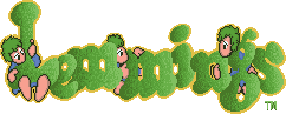
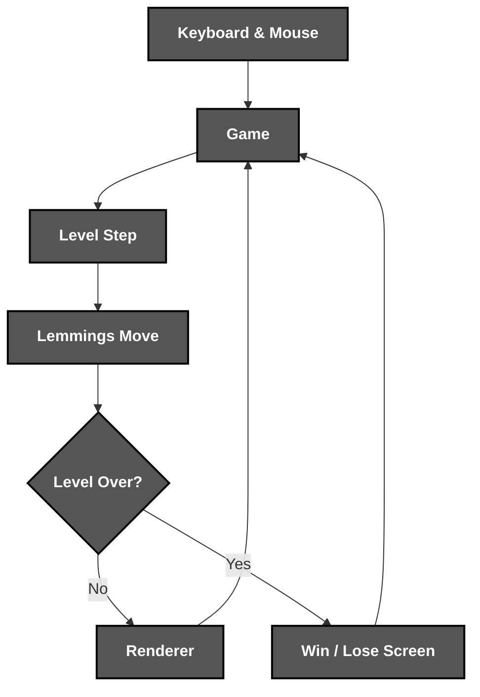
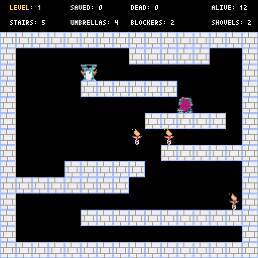

<div align="center">



*A retro **Lemmings** clone with procedurally generated levels*

</div>

# 📝 **Description**

<div align="center">

***Lemmings*** is a **retro puzzle game** where you guide lemmings to the exit through **procedurally generated** levels with ***umbrellas***, ***blockers***, ***stairs*** and ***shovels***
</div>
<br>
<div align="right">

***It was born as a first-year university project*** 🎓

</div>

# 🛠️ **Game Architecture & Workflow**

<div align="center">


</div>

# 📁 **Project Structure**

```
lemmings/
├── .gitattributes                                      # Git Attributes Configuration
├── .gitignore                                          # Git Ignore Rules
├── LICENSE                                             # Project License
├── pyproject.toml                                      # Package & Tool Configuration
├── README.md                                           # You are here! ⬅️
│
├── .github/workflows/
│   └── ci.yml                                          # Lint & Test Pipeline
│
├── assets/                                             # Visual Assets
│   ├── demo.gif                                        # Gameplay Recording
│   └── logo.png                                        # Game Logo
│
├── scripts/
│   └── stress_test.py                                  # Bot That Plays Random Levels
│
├── src/lemmings/
│   ├── __main__.py                                     # Entry Point
│   ├── game.py                                         # Screens, Input & Music
│   ├── renderer.py                                     # All Drawing
│   ├── level.py                                        # Level Rules & Win/Loss
│   ├── board.py                                        # Procedural Level Generation
│   ├── lemming.py                                      # Lemming Movement & Physics
│   ├── tools.py                                        # Umbrella, Blocker, Stairs & Shovel
│   ├── config.py                                       # Tiles, Rules & Sprite Coordinates
│   │
│   └── assets/
│       └── resources.pyxres                            # Sprites, Sounds & Music
│
└── tests/                                              # Unit Tests
```

# 🔧 **Installation**

## 📋 Requirements

- **Python 3.10+**

## ⚙️ Quick Setup

1. **Clone the repository**
   ```bash
   git clone https://github.com/cristiangilsanz/lemmings.git
   cd lemmings
   ```

2. **Create a virtual environment** *(recommended)*
   ```bash
   python -m venv .venv
   source .venv/bin/activate      # Windows: .venv\Scripts\activate
   ```

3. **Install the game**
   ```bash
   pip install -e .
   ```

<br>

# 🚀 **See *Lemmings* in Action**

## 🕹️ To Play the Game:

1. **Run the game:**

```bash
lemmings
```

2. **Press `Enter` to start, and `L` to release the lemmings!**

## 🧪 To Run the Tests:

1. **Install the development tools:**

```bash
pip install -e ".[dev]"
```

2. **Run the tests and the linter:**

```bash
pytest
ruff check .
```

3. **Stress-test the game** with a bot that plays random levels and reports any crash:

```bash
python scripts/stress_test.py 100
```

# 🎮 **Gameplay**

<div align="center">
    
</div>

<br>

## 🕹️ Controls

<div align="center">

| Key | Action | Description |
|:---:|---|---|
| `Enter` | Start Game | Starts the game or the next level |
| `L` | Release Lemmings | Opens the entrance for the lemmings |
| `P` | Place Umbrella | Slows a fall and survives one long drop *(4 per level)* |
| `B` | Place Blocker | Turns the lemmings around *(2 per level)* |
| `D` / `I` | Place Stairs | Builds a ramp up to the right / left *(5 per level)* |
| `C` | Place Shovel | Digs a hole through the platform below *(2 per level)* |
| `R` | Restart Game | Goes back to level 1 |
| `M` | Toggle Music | Turns the music on or off |
| `Q` | Quit Game | Closes the game |

</div>

> [!NOTE]
> 🥚 **Easter egg**
>
> Keep playing, and your lemmings might show up dressed for ***Christmas*** 🎄 or as ***Mario Bros*** 🍄!

# 💡 **Tips for Best Results**

To win a level, you must save **more than half** of your lemmings, and a fall of two tiles or more is fatal. Watch where they are heading, and use your limited tools wisely.

**Examples of a great move:**

> - Drop an ***umbrella*** in the path of a falling lemming to save it from a deadly drop.
> - Dig with a ***shovel*** when the exit is on a lower platform.
> - Build ***stairs*** in front of a ledge to climb up to the exit.
> - Place a ***blocker*** to turn back lemmings walking away from the exit.

# 📚 **Tech Stack & Other Resources**

## 📦 Tech Stack

### 🧩 **Programming Language**
- [Python](https://docs.python.org/3/)

### 🎮 **Game Engine**
- [Pyxel](https://github.com/kitao/pyxel)

### 🧪 **Testing**
- [Pytest](https://docs.pytest.org/)

### 🧹 **Code Quality**
- [Ruff](https://docs.astral.sh/ruff/)

### ⚙️ **Continuous Integration**
- [GitHub Actions](https://docs.github.com/actions)

# 🙏 **Credits & Thanks**

This game was created together with ***Alberto García Arribas*** 🤝 in our first year of university.

Thanks to [*Takashi Kitao*](https://github.com/kitao) for the wonderful **[Pyxel](https://github.com/kitao/pyxel)** engine, and to *DMA Design* for the original **Lemmings** ✨.

# 📄 **License**

This project is licensed under the MIT License - see the [LICENSE](LICENSE) file for details.

# 📞 **Get Help & Connect**

- 🐛 [Open an issue](https://github.com/cristiangilsanz/lemmings/issues)
- 📧 cristiangilsanz@gmail.com

<div align="center">
  <br>

  **Made with 💖 for the Retro Gaming Community**

  [⭐ Star this repo](https://github.com/cristiangilsanz/lemmings) | [🍴 Fork it](https://github.com/cristiangilsanz/lemmings/fork)

  <br>

  <a href="https://www.buymeacoffee.com/cristiangilsanz" target="_blank">
    
  </a>

</div>
